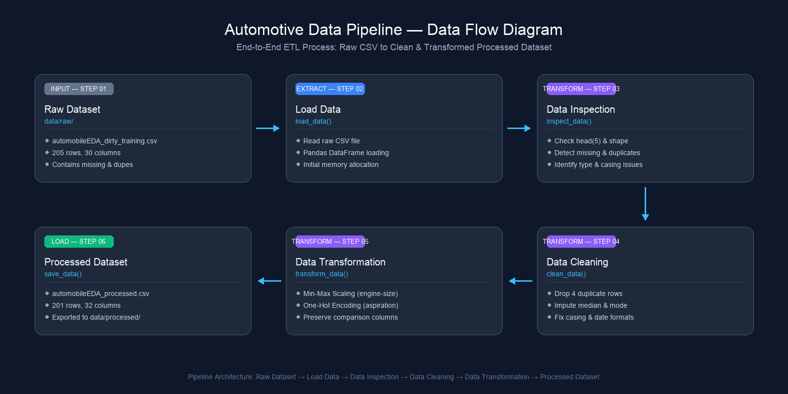

# Data Engineering Assignment: Pipeline & Preparation (Automotive Dataset)

## Deskripsi Singkat Dataset

Project ini menggunakan dataset otomotif (`automobileEDA_dirty_training.csv`) yang berisi berbagai informasi spesifikasi teknis kendaraan, harga, serta data transaksi. Dataset ini sengaja memiliki beberapa permasalahan kualitas data (_data quality issues_) seperti nilai kosong (_missing values_), baris duplikat, inkonsistensi format tanggal, serta variasi kapitalisasi teks kategori yang memerlukan proses pembersihan dan transformasi terstruktur.

## Sumber Dataset

Dataset diperoleh dari materi pelatihan AI Engineering Bootcamp (Studi Kasus Sesi 3 - Data Pipeline & Preparation).

## Struktur Folder Project

```text
data-pipeline-assignment/
├── data/
│   ├── raw/
│   │   └── automobileEDA_dirty_training.csv
│   └── processed/
│       └── automobileEDA_processed.csv
├── src/
│   └── pipeline.py
├── documentation/
│   └── data-flow-diagram.png
├── README.md
└── requirements.txt
```

---

## Kondisi Awal Dataset & Permasalahan yang Ditemukan

Berdasarkan hasil pemeriksaan awal (_data inspection_) pada `pipeline.py`, berikut ringkasan temuan kondisi dataset awal:

1. **Ukuran Awal Dataset:**
   - Memiliki **205 baris** dan **30 kolom**.

2. **Kolom yang Memiliki Missing Values:**
   - Total terdapat **17 missing values** yang tersebar pada:
     - `stroke` (4 missing)
     - `horsepower` (3 missing)
     - `price` (3 missing)
     - `transaction_date` (2 missing)
     - `make` (2 missing)
     - `num-of-doors` (2 missing)
     - `horsepower-binned` (1 missing)

3. **Jumlah Baris yang Terduplikasi:**
   - Ditemukan **4 baris duplikat** identik.

4. **Kolom dengan Tipe Data yang Belum Sesuai:**
   - `transaction_date`: Terbaca sebagai tipe teks (`str`/`object`), seharusnya berupa tipe `datetime`.
   - `normalized-losses`: Bertipe `int64`, sebaiknya dikelola sebagai `float64` jika terdapat nilai kosong atau desimal.

5. **Penulisan Kategori yang Belum Konsisten:**
   - Ditemukan inkonsistensi kapitalisasi huruf (_casing_) dan spasi liar pada kolom kategorikal:
     - Kolom `make`: Terdapat variasi huruf besar/kecil (misal `alfa-romero` vs `ALFA-ROMERO`, `audi` vs `Audi`) dan trailing space (`dodge  `).
     - Kolom `body-style`: Variasi penulisan seperti `sedan`, `Sedan`, dan `SEDAN`.
     - Kolom `drive-wheels`: Variasi singkatan seperti `rwd` vs `RWD`, serta `4wd` vs `AWD`.
     - Kolom `fuel-system`: Variasi huruf besar/kecil seperti `mpfi`, `MPFI`, dan `Mpfi`.

6. **Permasalahan Lain yang Ditemukan:**
   - Format tanggal tidak seragam pada kolom `transaction_date` (campuran antara format `YYYY-MM-DD`, `DD/MM/YYYY`, dan format teks bulan `DD-Mon-YYYY`).
   - Adanya spasi berlebih (_leading/trailing whitespace_) pada data teks kategori.

---

## Proses Data Cleaning & Alasan Pemilihan Metode

### Permasalahan yang Ditemukan

Dari tahap inspeksi, ditemukan beberapa masalah kualitas data berikut:

- **4 baris duplikat** identik.
- **17 missing values** tersebar pada 7 kolom (`stroke`, `horsepower`, `price`, `transaction_date`, `make`, `num-of-doors`, `horsepower-binned`).
- **Inkonsistensi penulisan kategori** (variasi huruf besar/kecil dan spasi liar) pada kolom `make`, `body-style`, `drive-wheels`, dan `fuel-system`.
- **Tipe data belum sesuai** pada kolom `transaction_date` (terbaca sebagai teks, bukan `datetime`).
- **Format tanggal tidak seragam** (campuran `YYYY-MM-DD`, `DD/MM/YYYY`, `DD-Mon-YYYY`).

### Kolom yang Dibersihkan, Metode, dan Alasan

| No  | Kolom yang Dibersihkan                                          | Metode Cleaning                                                  | Alasan                                                                                                                                                                                                     |
| :-- | :-------------------------------------------------------------- | :--------------------------------------------------------------- | :--------------------------------------------------------------------------------------------------------------------------------------------------------------------------------------------------------- |
| 1   | Seluruh dataset (baris)                                         | `drop_duplicates()` — menghapus baris duplikat                   | Baris ganda mendistorsi analisis dan memberikan bobot berlebih pada data yang sama saat pemodelan.                                                                                                         |
| 2   | `make`, `body-style`, `drive-wheels`, `fuel-system`             | `str.lower().str.strip()` — lowercase & hapus spasi berlebih     | Menyeragamkan penulisan kategori agar nilai yang sama tidak terbaca sebagai kategori berbeda (misal `alfa-romero` vs `ALFA-ROMERO`, `dodge` vs `dodge  `).                                                 |
| 3   | `transaction_date`                                              | `pd.to_datetime()` — konversi tipe data ke `datetime`            | Format tanggal yang beragam perlu distandarkan agar valid untuk analisis berbasis waktu. Menggunakan `errors='coerce'` agar format yang tidak dikenali menjadi `NaT` dan ditangani pada tahap selanjutnya. |
| 4   | `price`, `horsepower`, `stroke`                                 | `fillna(median)` — mengisi missing values numerik dengan median  | Median dipilih karena lebih tahan terhadap nilai ekstrem (_outliers_) dibandingkan _mean_, sehingga tidak menggeser distribusi data secara signifikan.                                                     |
| 5   | `num-of-doors`, `horsepower-binned`, `transaction_date`, `make` | `fillna(mode)` — mengisi missing values kategorikal dengan modus | Modus (nilai yang paling sering muncul) dipilih agar data tetap konsisten dengan pola mayoritas pada dataset. Baris tidak dihapus agar jumlah data tidak berkurang berlebihan.                             |

### Jumlah Data Sebelum dan Sesudah Cleaning

- **Jumlah baris sebelum cleaning:** 205 baris
- **Jumlah baris sesudah cleaning:** 201 baris (4 baris duplikat dihapus)
- **Missing values sebelum cleaning:** 17
- **Missing values sesudah cleaning:** 0

---

## Proses Data Transformation

### 1. Rincian Kolom & Metode Transformasi

1. **Normalisasi Min-Max Scaling pada Kolom Numerik (`engine-size`):**
   - **Nama Kolom:** `engine-size`
   - **Metode:** Min-Max Scaling (rentang [0, 1]).
     $$\text{Formula: } X_{norm} = \frac{X - X_{min}}{X_{max} - X_{min}}$$
   - **Alasan Pemilihan Kolom:** Kolom `engine-size` merupakan fitur teknis utama yang memiliki rentang nilai cukup besar (dari nilai minimum 61 hingga maksimum 326). Skala yang lebar ini berpotensi mendominasi perhitungan algoritma berbasis jarak jika tidak diskalakan. Min-Max Scaling dipilih agar rentang nilainya seragam antara 0 dan 1 tanpa mengubah distribusi proporsional data.
   - **Kolom Baru yang Dihasilkan:** `engine-size_normalized` (kolom asli tetap dipertahankan untuk referensi komparasi).

2. **One-Hot Encoding pada Kolom Kategorikal (`aspiration`):**
   - **Nama Kolom:** `aspiration`
   - **Metode:** One-Hot Encoding (`pd.get_dummies`).
   - **Alasan Pemilihan Kolom:** Kolom `aspiration` merepresentasikan sistem induksi udara kendaraan dengan dua kategori nominal: `std` (standard) dan `turbo`. Karena data ini bertipe nominal murni tanpa urutan tingkatan (_ordinal_), One-Hot Encoding adalah metode paling tepat agar model tidak mengasumsikan adanya peringkat artifisial antar kategori.
   - **Kolom Baru yang Dihasilkan:** `asp_std` dan `asp_turbo` (bertipe integer `0` atau `1`). Kolom asli `aspiration` tetap disimpan agar dapat dibandingkan langsung.

---

### 2. Contoh Tabel Perbandingan Nilai Sebelum dan Sesudah Transformasi

Berikut adalah perbandingan nilai sampel sebelum dan sesudah tahap transformasi:

| Index / Sampel | Kolom Asli    | Nilai Sebelum | Kolom Baru (Hasil Transformasi) | Nilai Sesudah | Keterangan                                                  |
| :------------- | :------------ | :------------ | :------------------------------ | :------------ | :---------------------------------------------------------- |
| **Baris 0**    | `engine-size` | `130`         | `engine-size_normalized`        | `0.2604`      | $\frac{130 - 61}{326 - 61} = \frac{69}{265} \approx 0.2604$ |
| **Baris 2**    | `engine-size` | `152`         | `engine-size_normalized`        | `0.3434`      | $\frac{152 - 61}{326 - 61} = \frac{91}{265} \approx 0.3434$ |
| **Baris 3**    | `engine-size` | `109`         | `engine-size_normalized`        | `0.1811`      | $\frac{109 - 61}{326 - 61} = \frac{48}{265} \approx 0.1811$ |
| **Baris 0**    | `aspiration`  | `std`         | `asp_std`, `asp_turbo`          | `1`, `0`      | Kategori `std` terdeteksi aktif                             |
| **Baris 8**    | `aspiration`  | `turbo`       | `asp_std`, `asp_turbo`          | `0`, `1`      | Kategori `turbo` terdeteksi aktif                           |

---

## Cara Instalasi & Menjalankan Project

### 1. Membuat dan Mengaktifkan Virtual Environment

Buka terminal pada folder project, lalu jalankan perintah berikut:

```bash
# Membuat virtual environment
python -m venv venv

# Mengaktifkan virtual environment (macOS / Linux)
source venv/bin/activate

# Mengaktifkan virtual environment (Windows Command Prompt)
venv\Scripts\activate.bat
```

### 2. Menginstal Dependency

Instal library yang dibutuhkan melalui file `requirements.txt`:

```bash
pip install -r requirements.txt
```

### 3. Menjalankan Pipeline

Jalankan script utama ETL untuk mengeksekusi seluruh tahapan (Extract, Inspect, Clean, Transform, Load):

```bash
python src/pipeline.py
```

---

## Penjelasan Singkat Alur ETL & Lokasi Hasil

Project ini menerapkan prinsip **ETL (Extract, Transform, Load)** dalam satu kali eksekusi script:

1. **Extract:** Membaca file mentah dari folder `data/raw/automobileEDA_dirty_training.csv`.
2. **Transform:** Melakukan pemeriksaan data (`inspect_data`), pembersihan (*cleaning*), normalisasi (Min-Max Scaling), dan encoding (One-Hot Encoding).
3. **Load:** Menyimpan hasil akhir secara otomatis ke dalam folder `data/processed/automobileEDA_processed.csv` tanpa mengubah data mentah asli.

### Data Flow Diagram
Berikut diagram alur visual pipeline data:


